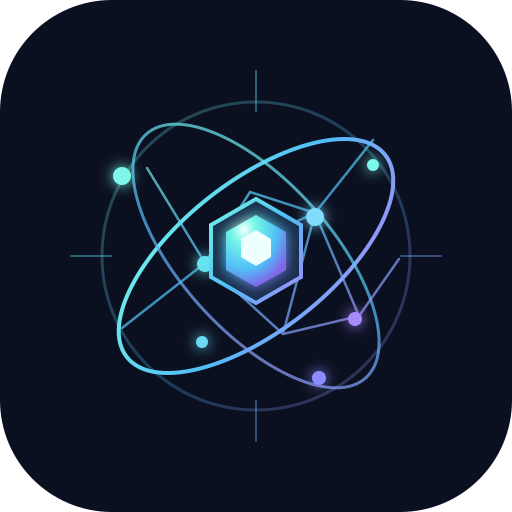

# Aetheris - 3D Cognitive Observatory for Autonomous AI Agents

<p align="center">
  
</p>

[](https://marketplace.visualstudio.com)
[](https://opensource.org/licenses/MIT)
[](#building-and-testing)

A real-time developer observability suite and 3D cognitive observatory for monitoring, normalizing, storing, and visualizing AI coding agent activity (Google Antigravity, GitHub Copilot, and Visual Studio Code workspace edits) as an interactive spherical constellation mesh.

---

## Architecture and Overview

Aetheris provides comprehensive runtime visibility into autonomous AI agent actions. When agents read documentation, inspect codebase graphs, issue terminal executions, or edit source files, every event is ingested through low-latency telemetry adapters, sanitized for privacy, persisted in an embedded SQLite database, and projected across a high-performance 60 FPS Canvas 2D engine.

### 3D Cognitive Observatory (Aetheris Engine)

1. Full Viewport Background Observable Space:
   - The 3D constellation engine renders across the entire viewport background, allowing unrestricted zooming and 360-degree orbital exploration.
   - All HUD controls and telemetry modules float as frosted glass overlay panels using Apple, macOS, and iOS design guidelines (20px blur, 180% saturation, translucent dark tint, subtle borders, and layered depth).

2. High-Performance 60-144 FPS Graphics Architecture:
   - Spatial Edge Frustum Culling: Edge vertices are evaluated in 2D and 3D screen space; edges where both vertices fall beyond frustum margins are rejected prior to stroke buffer allocation.
   - Adaptive Dynamic Framerate Budgeting: Monitors frame computation durations in real time. If frame execution exceeds 16.0ms, dynamic Level of Detail (LOD) coarsening automatically skips secondary intra-cluster webs and throttles background starfield passes to lock steady 60-144 FPS.
   - Pre-Rendered Sprite Atlas: Replaces expensive per-frame radial gradient allocations with cached offscreen canvas sprites, eliminating garbage collection pauses.
   - Zero-Allocation Projection Buffers: Reuses in-place projection scratch buffers for nodes, core polyhedrals, and star clusters.

3. Continuous Camera Node Follow (3D Focus Tracking):
   - When a file node is focused in 3D, the camera target LookAt coordinates continuously track the node's position as it moves or as the galaxy orbits.
   - The camera centers and orbits directly around the selected node rather than being pinned to the scene origin.
   - A dedicated return control allows one-click unbinding and smooth return to scene center.

4. Shortest-Path Angular Velocity Stabilization:
   - Camera rotation employs shortest-path angular delta wrapping `((targetYaw - yaw) % (2 * PI))` normalized within `[-PI, PI]`.
   - Eliminates rapid spinning artifacts during spotlight search or manual focus transitions while auto-orbit is toggled.

5. Side-Docked Live Agent Trace:
   - Positioned neatly at the bottom-left edge without obstructing central constellation nodes.
   - Features real-time log streaming with granular filters (All, Write, Read, Exec, Think) and one-click node spotlighting.

6. AI Cognition Stream and Multi-Project Reasoning:
   - Bottom-docked reasoning drawer supporting multi-project workspaces.
   - Real-time Markdown rendering for AI reasoning steps, duration tracking badges, and synchronized cause-and-effect timelines linking thoughts directly to produced file actions.

---

## Differentiated Capabilities and USPs

Aetheris addresses critical gaps in conventional agent interfaces through five primary Unique Selling Propositions:

1. Blast Radius and Architectural Shockwave:
   - When an agent modifies a file, Aetheris executes directed graph traversals across imported static dependencies to identify downstream consumer files.
   - Emits an animated chromatic shockwave through dependency edges, classifying downstream impact as Safe Consumer (Green), Test Suite Impacted (Amber), or Critical Interface Contract Hazard (Red).

2. Cognitive Rewind and Quantum Checkpoints:
   - Every cognitive reasoning turn recorded in the Cognition Dock serves as an interactive time-travel checkpoint.
   - Selecting "Rewind to Turn #N" restores the visual state of the 3D constellation to that exact moment in reasoning history, dimming subsequent modifications and displaying an active time-travel status banner.

3. Agent Cockpit (Follow-Me Spectator Autopilot):
   - An intelligent spectator autopilot camera that dynamically pans, zooms, and tracks agent tool executions in real time.
   - When the agent inspects documentation, performs symbol searches, or writes code, the camera glides smoothly to frame the active node with cinematic easing. User interaction automatically pauses autopilot to avoid control contention.

4. Multi-Agent Concurrency Collision Radar:
   - Tracks operational zones across distinct agent runtimes (Antigravity, GitHub Copilot, and external terminal providers).
   - If two distinct agents modify the same file or adjacent dependency within a 60-second window, Aetheris triggers a high-visibility Collision Hazard aura on the affected node, sounds an audible synth alert, and updates the HUD radar indicator.

5. Context Blindspot and Hallucination Sentinel:
   - Audits whether an agent modified a file without having first read its imported dependencies during the active session.
   - Files edited blindly are flagged with an unread dependency warning badge and highlighted in code trace cards to prevent hallucinated interface assumptions.

---

## Core Features

1. Constellation Graph and Cluster Hulls
   - Hardware-accelerated 60 FPS perspective projection engine with depth-sorted painter's rendering.
   - Spherical cluster hulls with polyhedral geometric wireframes and orbital latitude rings.
   - Luminous dependency edges derived from static import parsing with travelling signal energy packets.
   - Procedural WebAudio synthesizer delivering distinct sonic feedback for read, write, create, shockwave, and thinking events.

2. Code Trace Live Stack
   - High-fidelity frosted cards displaying recent file modifications and code diffs with syntax highlighting.
   - Non-cutting flex layout with independent vertical scrolling.
   - Instant click-to-focus linking directly into the 3D graph and editor.

3. Multi-Agent Adapters
   - Google Antigravity Adapter: Tails live transcript JSONL streams, parsing reasoning thoughts, tool calls, and lifecycle hooks.
   - GitHub Copilot Adapter: Ingests telemetry tool calls (read_file, grep_search, run_in_terminal, edit_file).
   - Visual Studio Code Workspace Adapter: Tracks document modifications, directory creations, deletions, and focus changes.
   - Loopback HTTP Bridge: Secure local listener on port 5174/5175 with Server-Sent Events (SSE) broadcasting.

4. Privacy and Persistence
   - Embedded SQLite WebAssembly database (`sql.js`) requiring zero external server dependencies.
   - Automated secret sanitization for API keys, bearer tokens, AWS credentials, and environment secrets.
   - Configurable retention policies with automated pruning.

---

## Quick Start and Automated PC Deployment

The system is fully portable and self-contained across Windows, macOS, and Linux. It utilizes WebAssembly SQLite (`sql.js`), Node.js, and standard HTML5 Canvas, eliminating native compilation dependencies (such as node-gyp or Python build toolchains).

To deploy and run on any new machine, clone or copy the project folder and use the platform-specific automated installer.

### Automated Turnkey Setup (Recommended)

The automated setup scripts verify Node.js (>= 18) and npm, install project dependencies, compile TypeScript, build production bundles, package the `.vsix` extension, and automatically install the extension into Visual Studio Code if the `code` CLI is available on PATH.

#### Windows (Command Prompt)
```cmd
setup.bat
```

#### Windows (PowerShell)
```powershell
powershell -ExecutionPolicy Bypass -File setup.ps1
```

#### macOS and Linux
```bash
chmod +x setup.sh start.sh
./setup.sh
```

#### Universal (Any OS with Node.js)
```bash
npm run setup
```

---

### Launching the Visualizer

#### Web Dashboard & Live Bridge Mode
Start the live bridge server and automatically open the interactive 3D observatory in your default browser at `http://127.0.0.1:5175/`:

- **Windows Command Prompt:** `start.bat`
- **Windows PowerShell:** `powershell -ExecutionPolicy Bypass -File start.ps1`
- **macOS / Linux:** `./start.sh`
- **Universal:** `npm start`

#### Visual Studio Code Extension Mode
If installed into Visual Studio Code:
1. Open Visual Studio Code in any workspace.
2. Open the Command Palette (`Ctrl+Shift+P` / `Cmd+Shift+P`).
3. Execute `Aetheris: Open 3D Observatory`.

---

### Extension Commands

Access via the Command Palette (`Ctrl+Shift+P` / `Cmd+Shift+P`):

- `Aetheris: Open 3D Observatory` - Opens the primary 3D cognitive observatory.
- `Aetheris: Start Recording` - Resumes background telemetry capture.
- `Aetheris: Stop Recording` - Pauses background telemetry capture.
- `Aetheris: Pause Recording` - Pauses background telemetry capture.
- `Aetheris: Resume Recording` - Resumes background telemetry capture.
- `Aetheris: Clear Current Session` - Resets stored events for the active session.
- `Aetheris: Export Current Session` - Exports session telemetry as sanitized JSON.
- `Aetheris: Show Diagnostics & Logs` - Opens the diagnostic output channel.

---

## Configuration Settings

The extension can be customized through Visual Studio Code settings under `aiActivityVisualizer`:

| Setting | Default | Description |
|---|---|---|
| `aiActivityVisualizer.recordingEnabled` | `true` | Automatically starts recording on workspace launch. |
| `aiActivityVisualizer.retentionDays` | `30` | Maximum retention period in days for SQLite event logs. |
| `aiActivityVisualizer.maxEventsPerSession` | `20000` | Maximum event capacity per session. |
| `aiActivityVisualizer.graphNodeLimit` | `1000` | Maximum number of file nodes rendered in the graph. |
| `aiActivityVisualizer.httpReceiverPort` | `5174` | Local loopback port for HTTP event ingestion. |
| `aiActivityVisualizer.enabledAdapters` | `["vscode", "copilot", "antigravity", "http"]` | List of active adapters. |
| `aiActivityVisualizer.excludedPatterns` | `["**/node_modules/**", "**/.git/**", "**/dist/**", ...]` | Glob patterns excluded from activity recording. |

---

## Building and Testing

Prerequisites: Node.js (version 18 or higher) and npm.

```bash
# Clean dependency installation
npm install

# TypeScript compilation check
npm run compile

# Unit and integration test suite (Vitest)
npm test

# Build production bundles (extension and webview)
npm run build

# Package installable VSIX package
npm run package

# Run live bridge server independently
npm start
```

---

## Cross-Platform Deployment Architecture

The extension is structured to ensure zero-friction transfer across different machines:
- **No Native Addons:** Database persistence is powered by `sql.js` (SQLite compiled to WebAssembly), avoiding prebuilt C++ binaries or architecture-specific compilation errors on ARM64 / x64.
- **Pure Web Standards:** The 3D cognitive observatory runs entirely on HTML5 Canvas 2D with a lightweight 3D orbital projection engine, requiring no WebGL hardware extensions or proprietary drivers.
- **Self-Contained Bridge:** `live_bridge_server.mjs` operates using standard Node.js built-ins (`http`, `fs`, `path`, `os`), running out-of-the-box on Windows, Linux, and macOS.

---

## License

This project is licensed under the MIT License. See the [LICENSE](LICENSE) file for details.
